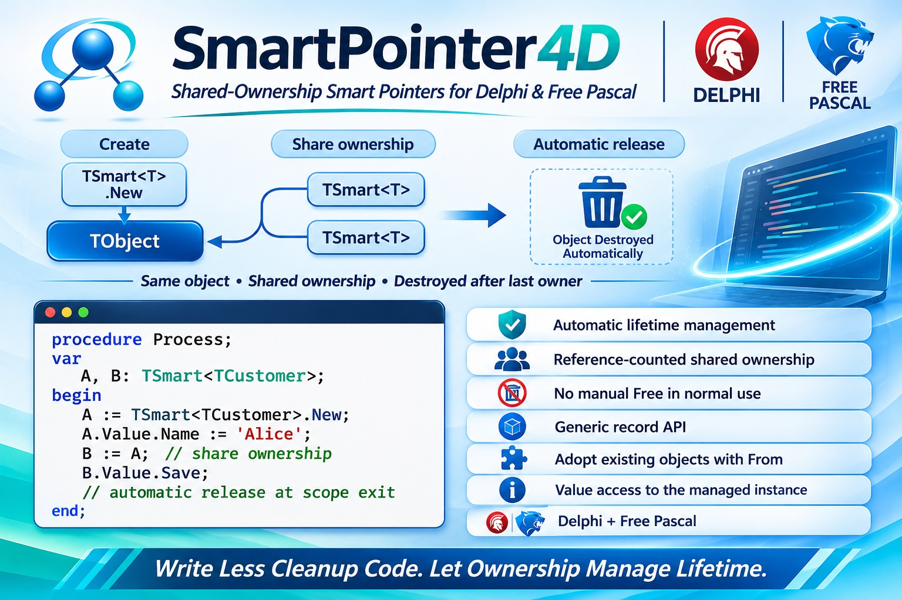



# SmartPointer4D

A lightweight shared-ownership smart-pointer library for **Delphi** and **Free Pascal**.

Both compilers use the same generic-record API. A reference-counted interface keeps the object alive while at least one smart-pointer copy exists; when the final copy leaves scope, the object is destroyed automatically.

## Quick start (Delphi and Free Pascal)

```pascal
uses
  SmartPointer4D;

var
  User: TSmart<TUser>;
begin
  User := TSmart<TUser>.New;
  User.Obj.Name := 'Shaahin';
  User.Obj.Save;
  // No Clear or Free call is needed. User is finalized automatically
  // when it leaves scope.
end;
```

## Sharing ownership

Copying a smart pointer shares ownership of the same object; it does not clone it.

```pascal
procedure RunSmartPointerDemo;
var
  First, Second: TSmart<TUser>;
begin
  First := TSmart<TUser>.New;
  First.Obj.Name := 'Shared object';

  Second := First;
  Second.Obj.Save;

  // No manual cleanup. The object is destroyed when the last local
  // smart-pointer record is finalized at the end of this routine.
end;
```

## Adopting an existing object

`From` transfers ownership of an existing instance to the smart pointer. Do not call `Free` on that instance afterward.

```pascal
var
  User: TSmart<TUser>;
begin
  User := TSmart<TUser>.From(TUser.Create);
  User.Obj.Save;
end;
```

## Is Clear required?

No. `Clear` is an optional operation for releasing one smart-pointer variable's ownership before it leaves scope. It is not required for normal memory management. Prefer ordinary scope-based cleanup:

```pascal
procedure DoWork;
var
  User: TSmart<TUser>;
begin
  User := TSmart<TUser>.New;
  User.Obj.Save;
  // Automatic release at routine exit.
end;
```

If other smart-pointer copies exist, calling `Clear` on one copy does not destroy the object until the last owner is released.

## Ownership rules

1. `TSmart<T>.From(Instance)` transfers ownership. Do not manually free `Instance` afterward.
2. Do not create separate smart pointers from the same raw object instance. Copy an existing smart pointer to share ownership.
3. `Obj` returns a borrowed object reference. Do not use it after all smart-pointer owners have been released.
4. This is shared ownership, not a weak-pointer implementation. Avoid ownership cycles.
5. `TSmart<T>.New` requires a public parameterless constructor.

## Compatibility

- Delphi: requires a version supporting generic records and generic constraints.
- Free Pascal: designed for FPC 3.2.x in Delphi mode.
- RTL only; no third-party dependencies.

The same `TSmart<T>` API is used by both compilers to avoid compiler-specific global generic functions and anonymous-method differences.

**Validation status:** the source and examples have been updated, but must still be compiled and runtime-tested with the exact Delphi and FPC versions targeted by the project.

## Delphi concise API

The shared API supports `New`, `From`, and `Obj`. For shorter Delphi call sites,
`Create` is an alias of `New`, `Own` is an alias of `From`, and `Obj` is the single object-access property in both Delphi and Free Pascal. It does
not forward arbitrary members of the wrapped class; access those through `Obj`.

```pascal
var
  User: TSmart<TUser>;
begin
  User := TSmart<TUser>.Create;
  User.Obj.Name := 'Shaahin';
  User.Obj.Save;
end; // managed ownership releases automatically at scope exit
```

## Build examples

- Delphi: open `Examples/Delphi/SmartPointer4D_DelphiDemo.dpr`. This single example demonstrates concise creation (`Create`), shared ownership, adoption (`Own`), and automatic scope-based release.
- Free Pascal: from the repository root run:

```sh
fpc -Fu./Source Examples/FreePascal/SmartPointer4D_FreePascalDemo.lpr
```

## License

MIT. See [LICENSE](LICENSE).

## Author

Created and maintained by **Shaahin Ashayeri**.

Project repository: [http://github.com/delphiMan68/SmartPointer4D](http://github.com/delphiMan68/SmartPointer4D)
